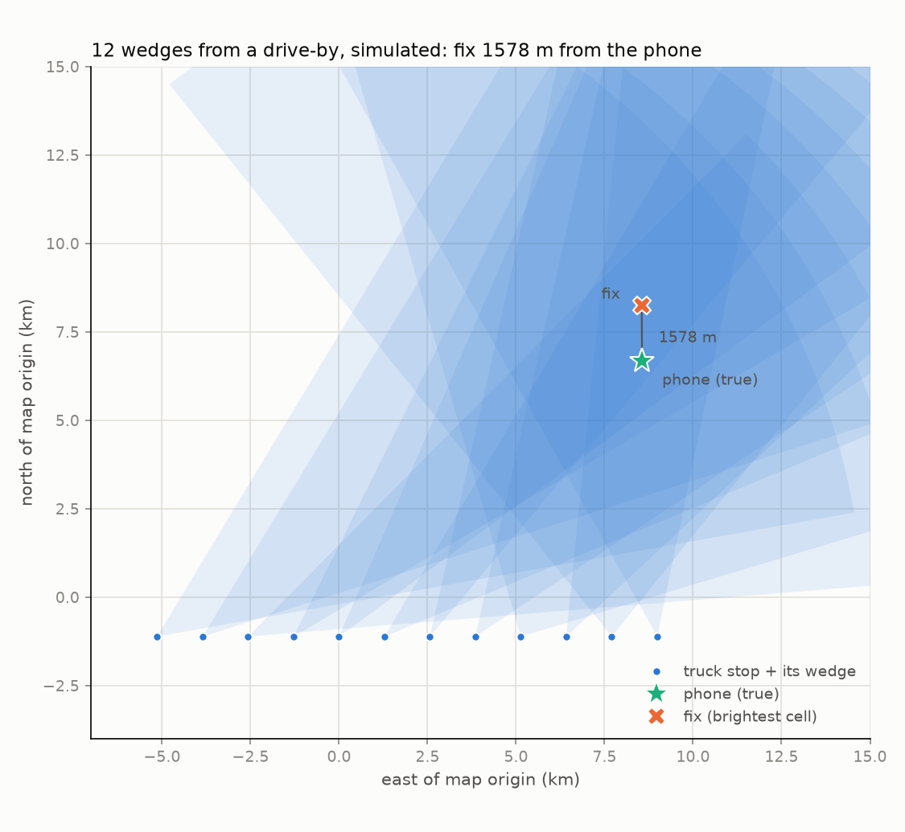

# BearingFix RF

A receive-only 2.4 GHz signal-strength and direction-finding learning project — built in public by, not a self-taught dev, but a self-learning dev.

Scope changed on 2026-09-19. Before that date this repo described a passive
phone locator for search and rescue, built around an 830 MHz cellular design.
That design is simulation only, not validated on hardware, and deferred. The
reasons are in [docs/decisions.md](docs/decisions.md).

## Objective

Build a receiver that shows the direction of a 2.4 GHz emitter I own, one
phase at a time. Each phase adds one unknown, has written pass criteria, and
ends in a test report under [docs/reports/](docs/reports/) stating what was
measured, how, under what conditions, and with what limitations.

## About

I drive a truck for a living and work on this about five hours a week. I'm teaching myself RF and signal processing from the ground up. The code is written with Claude; I'm learning to understand it well enough to explain the concepts, and the devlog records what I understand, what I don't yet, and what changed. Personal learning project: not taking PRs or issues for now, but read, run, and learn from it. If you really feel you have something to add or personal advice, please connect with me on LinkedIn or DM me on X.

## What it is

A receive-only instrument built from a HackRF Pro software-defined radio,
2.4 GHz dipole antennas, a laptop (Phase 0) and a Raspberry Pi 5 (Phase 1
onward). It is intended to report how strong a 2.4 GHz signal is and, in
later phases, which direction it comes from.

The repo also holds `bearing_df/`, a pseudo-Doppler direction-finding package
written in September 2026 for an 830 MHz cellular design with a switched
4-element array. It runs against a simulator only: simulation only, not
validated on hardware, deferred.

## Scope and safety

- Receive-only. Nothing in this project transmits.
- Own emitters only, or ones I am explicitly allowed to measure.
- No decoding of message content.

## What it's not

SAR teams have advanced systems that force a phone to ping by acting as a
proxy cell tower. If there's no tower, there's no ping, and these systems
solve that by bringing the tower with them. They excel in remote wilderness
and other true dead zones. BearingFix does not compete with them.

Those systems cost tens or hundreds of thousands of dollars, so they are
mostly owned by state and federal entities. Local teams have nothing.

Where BearingFix fits is in areas with enough coverage that a phone can
find a signal and is doing what it's programmed to do: trying to connect.
That covers tower-rich environments, and more to the point, tower-sparse
environments that still have *some* signal. The goal is a package that a
county or volunteer team can squeeze into its budget.

Scope note, 2026-10-10: the section above was written under the
search-and-rescue framing in use before 2026-09-19 and is kept as written.
Under the current scope the project is also not a calibrated instrument: it
reports dB relative to its own measured noise floor, never dBm.

## Status

As of 2026-10-10: Phase 0 hardware is received
([manifest](docs/hardware/manifest.md)). No measurements exist. The devlog
and the reports will record what I measure, including the disappointing
results. The wedge-map display is a design goal, not a shipped feature.

| Phase | State | Pass criteria (author-stated) |
|---|---|---|
| 0, first light: one dipole, laptop, own 2.4 GHz hotspot | In progress: hardware received, no measurements | (1) hotspot on/off is obvious in the printed number; (2) walking away lowers it steadily, walking back raises it; (3) I can state the noise floor and the peak in dB and roughly how far apart they are |
| 1, handheld viewfinder: Pi + phone compass ring, corner reflector behind one dipole | Not started | I find a hidden beacon three times running; I can explain one multipath ghost; I know whether the display paints the peak or the null |
| 2, four antennas: amplitude mode first, then pseudo-Doppler. Opera Cake enters here | Not started | A bearing appears while standing still |
| 3, vehicle + map: GPS-stamped bearings | Not started | Localize a planted beacon to within a stated distance (distance TBD) |

No phase has been passed. The Opera Cake antenna switch is not ordered; it is
bought only when Phase 2 starts.

## What works / what is unverified

Every claim in this repo is one of three kinds. **Measured**: observed and
recorded, with the conditions stated. **Author-stated**: my understanding or
intent, not checked against a measurement. **Expected**: what theory or a
simulation predicts.

| Item | Claim type | State and evidence |
|---|---|---|
| Simulator test suite | Measured (software test run, not an RF measurement) | 39 passed with pytest 9.1.1 on Python 3.14.4, Linux, 2026-10-10 |
| `bearing_df/hackrf_io.py` command flags | Reviewed against hackrf 2026.01.3 source; not run on hardware | See [docs/hardware-day-checklist.md](docs/hardware-day-checklist.md) for the items marked UNVERIFIED |
| Any RF measurement | None | No captures exist. [Phase 0 report](docs/reports/phase0-report.md): every result Pending |
| HackRF Pro powers up and identifies itself | Not yet verified | Pending, Phase 0 report |
| Phase 0 power meter | Not written | Intended behavior only: [phase0/README.md](phase0/README.md) |
| Simulation figures in [docs/technical.md](docs/technical.md) and [docs/sweeps/](docs/sweeps/) | Expected (simulator output) | 830 MHz design; simulation only, not validated on hardware, deferred |
| Pseudo-Doppler on a Wi-Fi-like wideband source | Not yet simulated | The technique was designed for narrowband carriers. A simulator run with a Wi-Fi-like source is a gate for Phase 2 |
| Python 3.10 to 3.13 | Declared in `pyproject.toml`, not verified | Tests have only been run on Python 3.14.4 |
| CI workflow | Not yet run | [.github/workflows/ci.yml](.github/workflows/ci.yml) cannot run until the branch is pushed |

## Repo map

| Path | What it is |
|---|---|
| `bearing_df/` | Pseudo-Doppler direction-finding package (830 MHz design; simulation only, deferred) |
| `tests/` | pytest suite that runs the package against its simulator; no hardware needed |
| `explore_sim.py` | Narrated single-burst walkthrough of the simulated pipeline |
| `explore_capture.py` | The same walkthrough for a `hackrf_transfer` recording; not yet run on a real capture |
| `tools/` | Parameter sweeps, wedge-map plot, HackRF + Opera Cake smoke test, Pi setup script |
| `phase0/` | Phase 0 power meter: intended behavior and pass criteria. No script yet |
| `data/` | Capture naming and metadata convention. IQ files are not committed |
| `docs/reports/` | Test report template and the Phase 0 report skeleton |
| `docs/hardware/` | Hardware manifest and connector notes |
| `docs/decisions.md` | Dated decision log, including the 2026-09-19 scope change |
| `docs/history/` | Index of documents written under the earlier framing |
| `docs/` (other files) | Devlog, technical writeup, sweeps and checklist for the 830 MHz design |

## Running the tests

```
python -m venv .venv
source .venv/bin/activate
pip install -e ".[dev]"
python -m pytest
python -m ruff check .
```

The lint rule set is deliberately narrow (syntax errors and undefined names
only). The existing code has not been restyled, and `ruff format` is not
enforced.

Commit messages follow `<scope>: <what changed and why>`.

## Try it

Scope note: this walkthrough simulates the deferred 830 MHz design
(simulation only, not validated on hardware).

No hardware needed. [explore_sim.py](explore_sim.py) puts one imaginary phone at a bearing you choose and narrates every stage of the pipeline as it finds it — raw I/Q, the switching tone, the phase at each antenna, the bearing, fusion, the map. Five knobs at the top, three seconds to run:

```
git clone https://github.com/ScottSagerDev1/bearingfix-rf
cd bearingfix-rf
pip install -e .
python explore_sim.py
```

What each stage means and what to try: [docs/explore_sim.md](docs/explore_sim.md).
Would rather read than install? A full example run: [docs/explore_sim_sample_output.txt](docs/explore_sim_sample_output.txt).



The script's last stage, drawn: each stop lays a wedge along its measured bearing, and where twelve of them pile up is the fix (`tools/plot_wedges.py`).

## Technical details

See [docs/technical.md](docs/technical.md).

## License and trademark

Source-available for noncommercial use (personal projects, education, research) under the [PolyForm Noncommercial License](LICENSE) — not open source in the community-contribution sense; see [TRADEMARKS.md](TRADEMARKS.md) for name usage.
